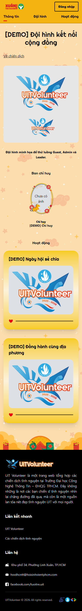
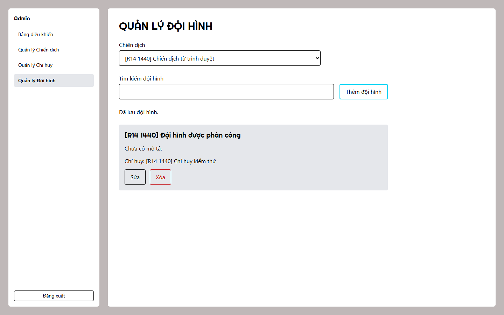
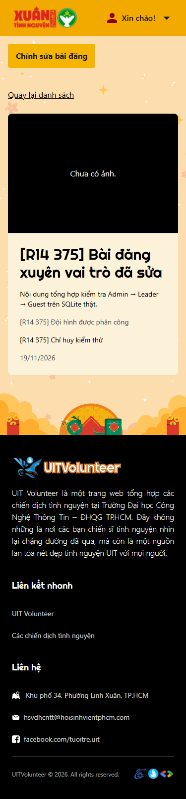
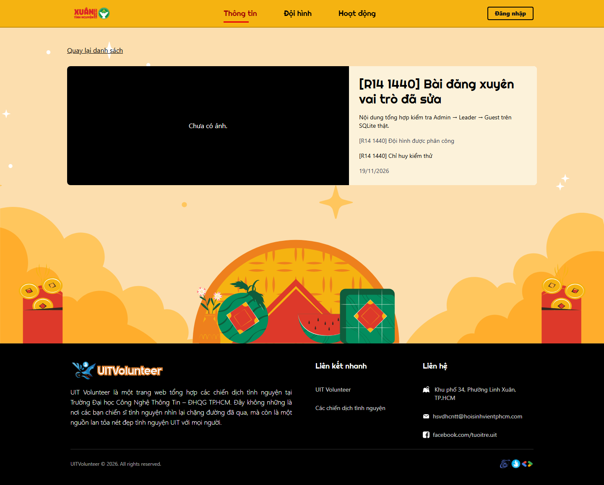

# UIT Volunteer Map

A UIT volunteer-campaign map and publishing application. Guests browse campaigns,
teams and activity posts; Admins provision Leader accounts and assignments;
Leaders manage their own team and posts. This checkout contains the local R01–R14
release work. It is not a claim of a deployed or approved v1 release.

## Implemented scope

- Public campaign/team/post reads, ordered galleries and reloadable links backed by SQLite APIs.
- A packaged Vietnam outline with markers bound to each post's persisted coordinates; keyboard marker selection opens that post.
- Admin campaign/team management, Leader-account provisioning/deactivation and coherent team assignment.
- Leader own-team resolution, team editing and persistent post create/edit/delete with server-derived authorship and cross-team write protection.
- Transactional database media writes, session verification/expiry/logout cleanup, explicit origin policy and bounded login attempts.

The stack is React 19, TypeScript, Vite 6, Tailwind CSS, TanStack Query, React Router
and Leaflet on the frontend; Express 4, TypeORM, SQLite, Zod, JWT and bcrypt on the
backend. `packages/shared` exports runtime JS and shared transport DTOs. Cloudinary
unsigned upload is the optional existing media path; API secrets never belong in
frontend variables.

## Local setup and synthetic demo

Use **Node 24.22.3 LTS / npm 11.19.1**, matching `.nvmrc`, `packageManager` and CI.
The commands below use **PowerShell 7**. Select that runtime before `npm ci`.

```powershell
npm ci
if (!(Test-Path packages/backend/.env)) {
  Copy-Item packages/backend/.env.example packages/backend/.env
}
if (!(Test-Path packages/frontend/.env)) {
  Copy-Item packages/frontend/.env.example packages/frontend/.env
}
```

Preserve existing environment files and databases. For the demo, use an unused
absolute database path and private passwords. In **terminal 1**, from the repo root:

```powershell
$env:NODE_ENV = 'development'
$env:HOST = '127.0.0.1'
$env:PORT = '5000'
$env:CORS_ORIGINS = 'http://localhost:3001,http://127.0.0.1:3001'
$env:JWT_SECRET = Read-Host 'Private JWT secret (32+ random characters)' -MaskInput
$env:DB_PATH = Join-Path (Get-Location) 'output/demo/uit-demo.sqlite'
if (Test-Path -LiteralPath $env:DB_PATH) { throw 'Choose a new unused DB_PATH, or follow the existing-database guide.' }
New-Item -ItemType Directory -Force (Split-Path -Parent $env:DB_PATH) | Out-Null
npm run build
npm run migration:run:dist -w @uit-volunteer-map/backend
$env:DEMO_ADMIN_PASSWORD = Read-Host 'Demo Admin password (12+ characters)' -MaskInput
$env:DEMO_LEADER_PASSWORD = Read-Host 'Demo Leader password (12+ characters)' -MaskInput
npm run seed:dist -w @uit-volunteer-map/backend -- --demo
Remove-Item Env:DEMO_ADMIN_PASSWORD, Env:DEMO_LEADER_PASSWORD
npm run dev:backend
```

In **terminal 2**, from the same repo root:

```powershell
# Empty API URL uses the /api development proxy to localhost:5000.
$env:VITE_API_URL = ''
npm run dev:frontend
```

Open [the app](http://localhost:3001), then `/login`. Use `demo-admin` or
`demo-leader` with the passwords you supplied. Keep terminal 1's environment for
subsequent backend commands, or persist the chosen private values in your local
backend `.env`; do not commit them. An optional third terminal can run
`npm run dev:shared` while editing shared sources. The root `npm run dev` is a
sequential workspace runner; use the two terminal commands above.

The seed creates one explicitly marked synthetic campaign/team, two activity
posts and packaged example images. Sample coordinates and content are not real
volunteer-activity evidence. There are no built-in demo passwords. Demo seed is
opt-in, disabled in production and refuses nonempty/conflicting application data;
repeating a complete demo does not reset passwords or reactivate accounts.
Default `npm run seed` ensures roles only. Historical bootstrap migrations still
insert legacy accounts: review their credential/provisioning policy before any
production exposure.

For an existing database, **do not substitute the demo procedure**. Use the
[guarded upgrade, backup, restore and recovery guide](packages/backend/MIGRATIONS.md#r11-reproducible-setup-demo-and-recovery).
No deployment database has been inventoried by these local checks.

## Build and verification

```powershell
npm test
npm run lint
npm run typecheck
npm run build
npm run check:map
npm run test:smoke
npm run test:database
npx playwright install chromium
npm run test:journeys
```

`test:journeys` builds current output with an isolated same-origin API URL, applies
all 15 real migrations to a new disposable database, runs the demo seed twice,
checks auth/filter/transaction invariants and drives real Chromium UI at 375×667
and 1440×900. It uses no API/provider response mocks and no external uploads.
Existing optional Google Fonts are blocked for deterministic offline rendering;
packaged artwork/fonts and all application API responses remain real.
It removes its own browser/servers/database and checks the developer DB hash.
Results and screenshots go to `output/playwright/r14`. With output already built
in the same job using an empty `VITE_API_URL`, CI uses `-- --built` to avoid rebuilding.
For headed local verification: `npm run test:journeys -- --headed`.

The CI build job checks source and built map integrity, smoke-starts compiled JS,
rehearses migrations/backup/recovery, installs matching Chromium/system libraries
and runs the same browser journeys. Artifacts are named with the tested Git SHA.
Local results are recorded in the [R14 handoff](docs/handoffs/R14.md); no remote CI
pass is claimed for an unpushed branch.

For compiled local backend runtime, keep the configured environment/database and
run `npm start` after building. Vite's development proxy is not a production host.
A deployed frontend needs its `/api` reverse proxy or configured `VITE_API_URL`,
and history fallback for deep routes. Production backend requires explicit
`CORS_ORIGINS`, a private JWT secret of at least 32 characters, an intentional
`HOST` binding and a verified database migration/restore plan.

## Screenshots

These are executed local browser checks using synthetic demo data, not a live site.

| Guest: packaged demo, 375 px | Admin: real assignment, 1440 px |
|---|---|
|  |  |

| Leader: persisted post, 375 px | Guest: edited post after logout/reload, 1440 px |
|---|---|
|  |  |

## Limits and release dependencies

- Real Cloudinary preset/file restrictions and provider cleanup still need deployment verification. A failed publish can leave an external orphan upload; database rollback does not delete a provider asset.
- The map is a generalized Natural Earth 1:110m outline, not current provincial/commune coverage or navigation-grade geography. Posts without valid coordinates have no marker.
- The login budget is process-local and resets at restart. Proxy clients share a socket-IP budget with `trust proxy:false`; production scaling needs an explicit trusted proxy/shared throttling policy. Logout clears the client; it does not revoke already-issued JWTs server-side.
- Existing database histories require operator inventory and a rehearsed supported upgrade/recovery path. No production DB or live media account was used in acceptance.
- [R12](docs/handoffs/R12.md) records remaining dependency advisories and nonzero audit exits. R14 does not declare an audit-clean release. The existing frontend chunk-size warning remains.
- Core mobile/keyboard acceptance, truthful statistics/year controls and inert/deferred UI are the next **R15** scope. Advanced analytics, ViceLeader, public registration, social features and editorial tooling remain deferred. Static dashboard figures must not be presented as measured live activity.

## Contributions and attribution

This is a team repository. Examples below are tied to source commits, not an
exhaustive roster or a statement that one contributor built the entire product.
Aliases are kept as recorded in Git; contribution totals are not used as impact metrics.

| Git author | Source-supported examples |
|---|---|
| nphng15 | Entity/schema groundwork (`d09dd82`, `a9d5293`). |
| QUOC HAI | Campaign layout and shared header/footer navigation (`1c2e914`, `ddec775`). |
| Tran Thi Ngoc Xuyen | Existing layout/link work (`52df94d`) and earlier UI history. |
| KhoiNguyen8326 | Post actor/ownership checks (`807bb50`), scoped Guest bindings (`4cbca6e`), coordinate persistence (`b61b66c`) and transactional media (`ac5d7d9`). R14 extends release verification on that shared work. |

See the [repository commit history](https://github.com/GDSC-UIT/uit-volunteer-map/commits)
for other authors and exact changes. Reused artwork/components retain their
existing team origin; these checks do not establish authorship of every asset.

No repository-root license grant is present in this checkout. Confirm application
and campaign-artwork reuse terms with maintainers before redistribution; do not
infer a license from a dependency. The packaged boundary is Natural Earth 5.1.2
public-domain data, with pinned source/checksums and separate provenance in
[the map-data guide](packages/frontend/public/data/README.md). That data's terms do
not apply to the campaign artwork. Third-party packages retain their own licenses.
